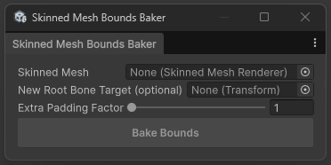

# Skinned Mesh Bounds Baker for Unity



A Unity tool to bake SkinnedMeshRenderer bounds relative to its Root Bone.

- Easily fix miscalculated bounds
- Update the bounds after setting a new root bone
- Bake bounds with extra padding
- Edit multiple renderers in multiple windows that survive domain reload.

## Installation

1. Press the green button with the `<> Code`label above.
2. From there, copy the HTTPS URL of this repository (the one that you would use for cloning the repo). 
3. In Unity, open the Package Manager.
4. Click the `+` button and select `Install package from git URL...`
5. Paste the URL and install the package.


## AI use disclosure

- The code in this package was generated with AI, then manually refactored.
- AI autocompletion was enabled in the IDE.

## License

[MIT](LICENSE.md)

```
MIT License

Copyright (c) 2026 Vladimir Klubkov

Permission is hereby granted, free of charge, to any person obtaining a copy
of this software and associated documentation files (the "Software"), to deal
in the Software without restriction, including without limitation the rights
to use, copy, modify, merge, publish, distribute, sublicense, and/or sell
copies of the Software, and to permit persons to whom the Software is
furnished to do so, subject to the following conditions:

The above copyright notice and this permission notice shall be included in all
copies or substantial portions of the Software.

THE SOFTWARE IS PROVIDED "AS IS", WITHOUT WARRANTY OF ANY KIND, EXPRESS OR
IMPLIED, INCLUDING BUT NOT LIMITED TO THE WARRANTIES OF MERCHANTABILITY,
FITNESS FOR A PARTICULAR PURPOSE AND NONINFRINGEMENT. IN NO EVENT SHALL THE
AUTHORS OR COPYRIGHT HOLDERS BE LIABLE FOR ANY CLAIM, DAMAGES OR OTHER
LIABILITY, WHETHER IN AN ACTION OF CONTRACT, TORT OR OTHERWISE, ARISING FROM,
OUT OF OR IN CONNECTION WITH THE SOFTWARE OR THE USE OR OTHER DEALINGS IN THE
SOFTWARE.
```
